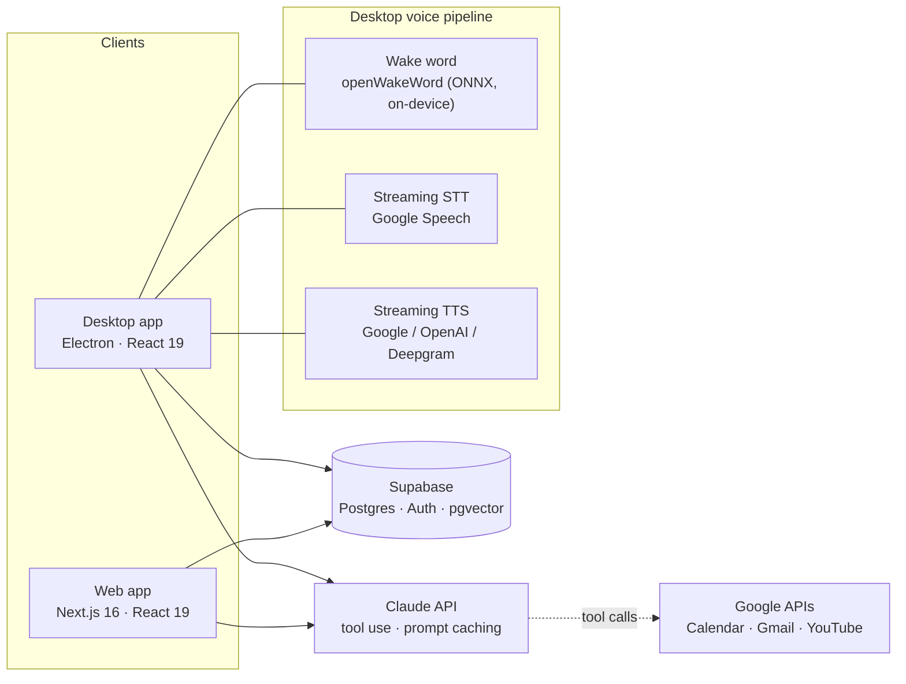

# Nova: a personal AI assistant with memory, voice and real tools

[](https://www.typescriptlang.org/)
[](https://nextjs.org/)
[](https://www.electronjs.org/)
[](https://www.anthropic.com/)
[](https://supabase.com/)
[](LICENSE)

Nova is a personal assistant that feels like **one brain across devices**. You can chat with it in the browser or talk to it hands-free on your desktop ("Hey Jarvis"). It remembers what matters about you, manages your reminders and calendar, reads and drafts email, and can control your computer, all backed by one shared memory and one account.

I designed and built it end to end: product, UX, backend, voice pipeline and desktop app.

---

## What it does

**Conversation and memory**
- Chat with streaming replies and multiple threads, with model routing between a fast model and a deeper-reasoning model.
- **Long-term memory** that saves durable facts automatically (preferences, routines, goals, people), deduplicates and merges them, and recalls them with **hybrid search**: pgvector embeddings plus `pg_trgm` keyword search, fused with Reciprocal Rank Fusion.
- A Memory Manager to browse, pin, archive and search what Nova knows.

**Getting things done (tool use)**
- **Reminders** with push notifications, and **Google Calendar** create/update/delete.
- **Gmail**: search, read, draft, and send with confirmation.
- **YouTube** search and recommendations from your taste profile, plus web search and page reading.
- **Scheduled agent loops**: "every morning at 8, brief me on my day" runs as an autonomous, tool-enabled task.

**Voice**
- On-device wake word, streaming speech-to-text, and sentence-by-sentence streaming text-to-speech.
- Barge-in (interrupt it mid-sentence), kill phrases ("that'll be all"), and continuous conversation mode.
- **Proactive speech**: reminder and calendar pre-alerts, timer completions and agent-loop results are spoken aloud, with quiet hours respected.

**Desktop companion (`nova-mac/`)**
- An always-on-top, Siri-style voice orb, with a full app window for Settings, Reminders, Memory and Connections.
- Computer control: volume, brightness, apps, media, AppleScript and Shortcuts on macOS. Code-running tools always ask for confirmation first.
- Runs on **macOS and Windows** through a platform-adapter layer.

---

## Architecture



Both clients share **one Supabase backend** (auth with row-level security, conversations, messages, memories, reminders, preferences and encrypted OAuth tokens), so a memory saved by voice on the desktop is available in the browser and vice versa.

**Request flow for one turn:** pre-retrieve context (memories, reminders, calendar, email highlights) → build a cached system prompt → stream from Claude → run tools in parallel and loop → stream the reply (and speak it, on the desktop) → persist the turn and extract memories in the background.

---

## Engineering highlights

- **On-device wake word.** A three-stage ONNX pipeline (mel spectrogram → embedding → "Hey Jarvis" classifier) runs in a worker thread. Getting the exact training-time preprocessing right (int16 scaling, mel normalisation, a streaming STFT context and embedding stride) was the difference between scores of ~0 and reliable detection. A thread-pool fix cut its CPU use from ~6.5 cores to ~2% of one.
- **Low-latency voice.** Speech is transcribed *while* you talk (PCM frames are teed to a streaming recogniser), replies are spoken sentence by sentence as they stream, and per-turn timing logs drove the work that took end-of-speech-to-audio from 30 s down to about 2 s.
- **Robust listening.** A noise-calibrated speech gate with hysteresis, a backstop for rooms where auto-gain lifts the noise floor, and a barge-in detector that pauses (rather than restarts) on false alarms caused by the assistant's own voice.
- **Cost and speed.** Prompt caching keeps the static system prompt and about 70 tool schemas cached across turns and tool rounds. Light/heavy model routing sends only genuinely complex asks to the larger model.
- **Honest tools.** A hard rule in the system prompt stops the model from claiming success unless the tool result confirms it. OS-level failures (macOS permissions) are rewritten into actionable fix-it steps.
- **Security.** OAuth refresh tokens are AES-256-GCM encrypted at rest; desktop sessions are stored with the OS keychain (`safeStorage`); shell, AppleScript and browser-JS tools need explicit user approval; there is no service-role key in the desktop client.
- **Tested.** 170 Vitest tests on the desktop app cover the orb state machine, voice activity detection, sentence chunking, memory merge/reconcile, scheduling, OAuth client caching and more. TypeScript strict mode is the build gate.

---

## Tech stack

| Area | Technologies |
|---|---|
| Web | Next.js 16 (App Router), React 19, Tailwind CSS v4, Vercel cron jobs |
| Desktop | Electron, electron-vite, React 19, framer-motion, WebGL orb |
| AI | Anthropic Claude (Haiku / Sonnet routing, tool use, prompt caching, server-side web search) |
| Data | Supabase (Postgres, Auth, RLS), pgvector, pg_trgm |
| Voice | openWakeWord via onnxruntime-node, Google Cloud Speech-to-Text (streaming), Google / OpenAI / Deepgram TTS |
| Integrations | Google Calendar, Gmail, YouTube (OAuth 2.0), Composio (optional) |
| Quality | TypeScript strict, Vitest |

---

## Repository structure

```
.
├── app/            Next.js routes: chat UI, memory, reminders, settings, API routes
├── components/     Web UI components
├── lib/            Assistant core: memory, tools, prompts, Google integrations, voice
├── supabase/       Database migrations (schema, RLS, pgvector, pg_trgm)
├── nova-mac/       Desktop companion (Electron): orb, voice pipeline, wake word, tools
└── docs/           Development guide, design specs and implementation plans
```

---

## Timeline

Dates come from the commit history.

| When | Milestone |
|---|---|
| **23 Jun 2026** | Project start: Next.js web app with chat, Supabase auth, long-term memory, reminders, and Google Calendar/Gmail/YouTube integrations |
| **29 Jun 2026** | Prompt caching with cost tracking, agentic workflows (web search, multi-step plans), streaming TTS |
| **30 Jun 2026** | Desktop companion started: always-on-top orb, tray, keychain sessions, on-device "Hey Jarvis" wake word |
| **1 Jul 2026** | Memory system and Google tools ported to the desktop on the shared backend |
| **2 Jul 2026** | Desktop app shell (Settings, Reminders, Memory, Connections), Siri-style UI, computer-control tools |
| **3–4 Jul 2026** | Streaming speech-to-text, Mac automation (AppleScript/Shortcuts), native web search, voice pipeline calibration |
| **5 Jul 2026** | Proactive voice engine: pre-alerts, scheduled agent loops, a personality that learns from feedback |
| **15 Jul 2026** | Windows support (phase 1) via a per-OS platform layer, custom voice-triggered skills, voice reliability pass |
| **17 Aug 2026** | Google OAuth client caching to eliminate token-refresh races |
| **13 Nov 2026** | Hardening: security review fixes, 300× wake-word CPU reduction, voice latency cut from 30 s to ~2 s |

---

## Roadmap

- Gmail real-time awareness (push notifications instead of polling)
- Windows phase 2: port the remaining desktop automation tools
- Activity audit log for everything the assistant does on your behalf
- Evaluate newer Claude models with latency-tuned settings

---

## Running it locally

Nova needs your own API keys (Anthropic, Supabase, OpenAI; Google Cloud for voice and Google integrations).

- **Web app:** see [`docs/DEVELOPMENT.md`](docs/DEVELOPMENT.md) for environment variables, database migrations and setup.
- **Desktop app:** see [`nova-mac/README.md`](nova-mac/README.md).

```bash
# Web app
npm install
npm run dev

# Desktop app
cd nova-mac
npm install
npm run wake:models   # download the wake-word models
npm run dev
```

---

## Acknowledgements

- Wake-word models from [openWakeWord](https://github.com/dscripka/openWakeWord) by David Scripka.
- Built with [Claude](https://www.anthropic.com/claude) and [Supabase](https://supabase.com/).

## License

[MIT](LICENSE) © 2026 Aryav Karthik
