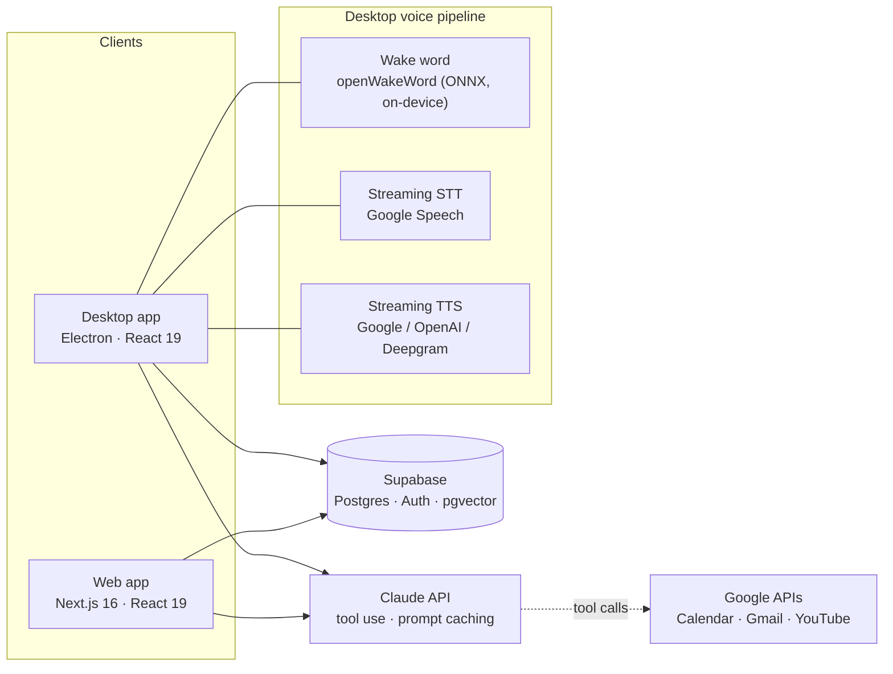

# Nova: a personal AI assistant with memory, voice and tools

[](https://www.typescriptlang.org/)
[](https://nextjs.org/)
[](https://www.electronjs.org/)
[](https://www.anthropic.com/)
[](https://supabase.com/)
[](LICENSE)

Nova is a personal assistant that feels like one brain across devices. You can chat with it in the browser or talk to it hands-free on your desktop by saying "Hey Jarvis". It remembers what matters about you, manages your reminders and calendar, reads and drafts email, and can control your computer, and all of it runs off one shared memory and one account.

I designed and built it end to end, covering the product, UX, backend, voice pipeline and desktop app.

## What it does

### Conversation and memory

- Chat with streaming replies and multiple threads, with model routing between a fast model and a deeper-reasoning one.
- Long-term memory that saves durable facts automatically (preferences, routines, goals, people), deduplicates and merges them, and recalls them with hybrid search: pgvector embeddings plus `pg_trgm` keyword search, fused with Reciprocal Rank Fusion.
- A Memory Manager to browse, pin, archive and search what Nova knows.

### Tool use

- Reminders with push notifications, and Google Calendar create, update and delete.
- Gmail search, reading, drafting, and sending with confirmation.
- YouTube search and recommendations based on your taste profile, plus web search and page reading.
- Scheduled agent loops, so a request like "every morning at 8, brief me on my day" runs as an autonomous task with full tool access.

### Voice

- An on-device wake word, streaming speech-to-text, and text-to-speech that streams sentence by sentence.
- Barge-in (you can interrupt it mid-sentence), kill phrases like "that'll be all", and a continuous conversation mode.
- Proactive speech, where reminder and calendar pre-alerts, timer completions and agent-loop results are read out loud while respecting quiet hours.

### Desktop companion (`nova-mac/`)

- An always-on-top voice orb in the style of Siri, with a full app window for Settings, Reminders, Memory and Connections.
- Computer control on macOS covering volume, brightness, apps, media, AppleScript and Shortcuts. Any tool that runs code asks for confirmation first.
- It runs on macOS and Windows through a platform-adapter layer.

## Architecture



Both clients share one Supabase backend (auth with row-level security, conversations, messages, memories, reminders, preferences and encrypted OAuth tokens), so a memory saved by voice on the desktop shows up in the browser and the other way round.

Each turn follows the same path. Nova pre-retrieves context (memories, reminders, calendar and email highlights), builds a cached system prompt and streams the reply from Claude, running any tools in parallel and looping until it's done. The reply streams back (and is spoken on the desktop), then the turn is saved and memories are extracted in the background.

## How it works

The wake word runs on-device as a three-stage ONNX pipeline (mel spectrogram, then embedding, then the "Hey Jarvis" classifier) in a worker thread. Matching the exact preprocessing the models were trained on (int16 scaling, mel normalisation, a streaming STFT context and the embedding stride) was the difference between scores of about 0 and reliable detection. A thread-pool fix later cut its CPU use from about 6.5 cores to 2% of one.

Voice is built for low latency. Speech is transcribed while you're still talking, because PCM frames are teed to a streaming recogniser, and replies are spoken sentence by sentence as they stream in. Per-turn timing logs guided the work that took the time from the end of your speech to the first audio from 30 s down to about 2 s.

Listening has to cope with real rooms. A noise-calibrated speech gate with hysteresis decides when you've started and stopped talking, there's a backstop for rooms where the mic's auto-gain lifts the noise floor, and the barge-in detector pauses (rather than restarts) when it gets a false alarm from the assistant's own voice.

Prompt caching keeps the static system prompt and about 70 tool schemas cached across turns and tool rounds, which saves both cost and time. Light/heavy model routing sends only the complex requests to the larger model.

Tool results are reported honestly. A hard rule in the system prompt stops the model from claiming something worked unless the tool result confirms it, and OS-level failures like macOS permission errors are rewritten into steps the user can follow to fix them.

On security, OAuth refresh tokens are encrypted at rest with AES-256-GCM and desktop sessions are stored in the OS keychain (`safeStorage`). Any tool that runs a shell command, AppleScript or browser JavaScript needs explicit approval from the user, and the desktop client has no service-role key.

The desktop app has 170 Vitest tests covering the orb state machine, voice activity detection, sentence chunking, memory merge and reconcile, scheduling, OAuth client caching and more. TypeScript strict mode is the build gate.

## Tech stack

| Area | Technologies |
|---|---|
| Web | Next.js 16 (App Router), React 19, Tailwind CSS v4, Vercel cron jobs |
| Desktop | Electron, electron-vite, React 19, framer-motion, WebGL orb |
| AI | Anthropic Claude (Haiku / Sonnet routing, tool use, prompt caching, server-side web search) |
| Data | Supabase (Postgres, Auth, RLS), pgvector, pg_trgm |
| Voice | openWakeWord via onnxruntime-node, Google Cloud Speech-to-Text (streaming), Google / OpenAI / Deepgram TTS |
| Integrations | Google Calendar, Gmail, YouTube (OAuth 2.0), Composio (optional) |
| Quality | TypeScript strict, Vitest |

## Repository structure

```
.
├── app/            Next.js routes: chat UI, memory, reminders, settings, API routes
├── components/     Web UI components
├── lib/            Assistant core: memory, tools, prompts, Google integrations, voice
├── supabase/       Database migrations (schema, RLS, pgvector, pg_trgm)
├── nova-mac/       Desktop companion (Electron): orb, voice pipeline, wake word, tools
└── docs/           Development guide, design specs and implementation plans
```

## Timeline

These dates come from the commit history.

| When | Milestone |
|---|---|
| 23 Jun 2026 | Project start: Next.js web app with chat, Supabase auth, long-term memory, reminders, and Google Calendar, Gmail and YouTube integrations |
| 29 Jun 2026 | Prompt caching with cost tracking, agentic workflows (web search, multi-step plans), streaming TTS |
| 30 Jun 2026 | Desktop companion started: always-on-top orb, tray, keychain sessions, on-device "Hey Jarvis" wake word |
| 1 Jul 2026 | Memory system and Google tools ported to the desktop on the shared backend |
| 2 Jul 2026 | Desktop app shell (Settings, Reminders, Memory, Connections), a Siri-style UI and computer-control tools |
| 3 and 4 Jul 2026 | Streaming speech-to-text, Mac automation (AppleScript and Shortcuts), native web search, voice pipeline calibration |
| 5 Jul 2026 | Proactive voice engine with pre-alerts, scheduled agent loops and a personality that learns from feedback |
| 15 Jul 2026 | Windows support (phase 1) through a per-OS platform layer, custom voice-triggered skills, a voice reliability pass |
| 17 Aug 2026 | Google OAuth client caching to stop token-refresh races |
| 13 Nov 2026 | Hardening: security review fixes, a 300× cut in wake-word CPU use, voice latency down from 30 s to about 2 s |

## Roadmap

- Gmail real-time awareness, using push notifications instead of polling
- Windows phase 2, porting the remaining desktop automation tools
- An activity audit log for everything the assistant does on your behalf
- Testing newer Claude models with latency-tuned settings

## Running it locally

Nova needs your own API keys for Anthropic, Supabase and OpenAI, plus Google Cloud for voice and the Google integrations.

- Web app: see [`docs/DEVELOPMENT.md`](docs/DEVELOPMENT.md) for environment variables, database migrations and setup.
- Desktop app: see [`nova-mac/README.md`](nova-mac/README.md).

```bash
# Web app
npm install
npm run dev

# Desktop app
cd nova-mac
npm install
npm run wake:models   # download the wake-word models
npm run dev
```

## Acknowledgements

- Wake-word models from [openWakeWord](https://github.com/dscripka/openWakeWord) by David Scripka.
- Built with [Claude](https://www.anthropic.com/claude) and [Supabase](https://supabase.com/).

## Licence

[MIT](LICENSE) © 2026 Aryav Karthik
